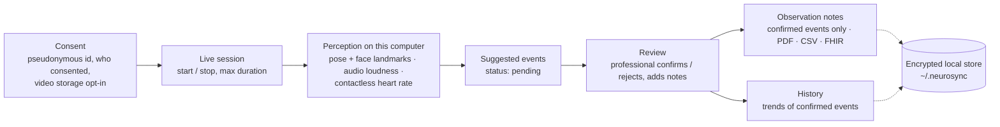
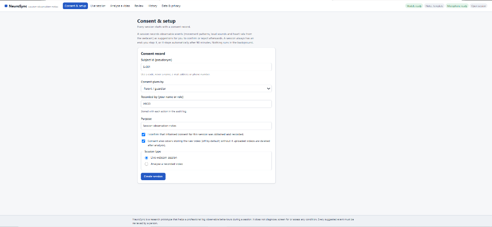
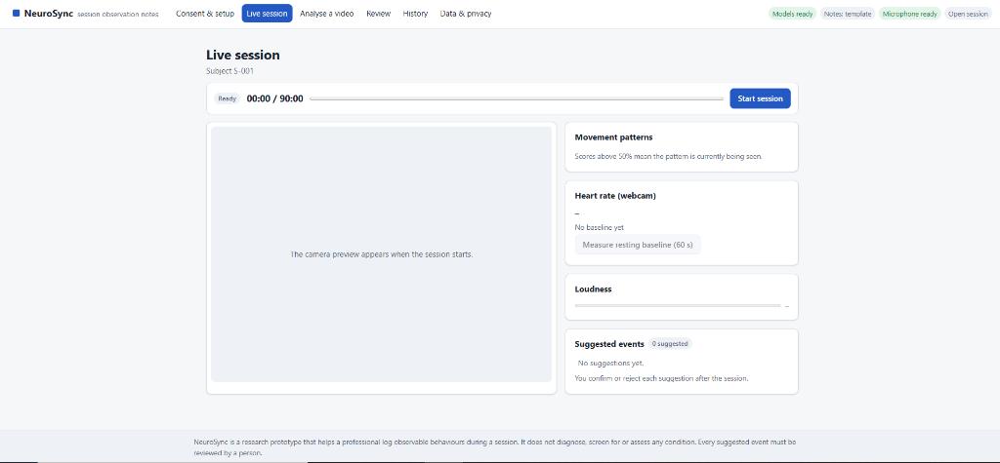
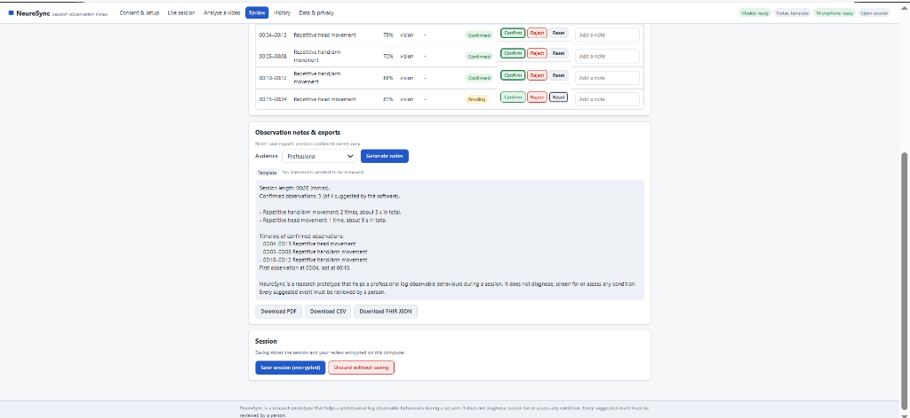
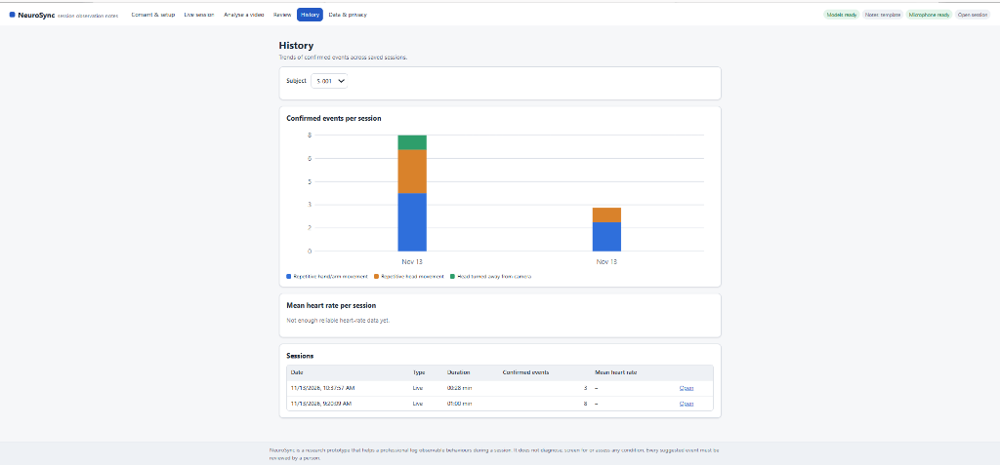

# NeuroSync

**A privacy-first, non-diagnostic session-observation assistant.** During a consented,
time-limited session it watches a webcam and microphone, suggests observable events
(repetitive hand/arm movement, repetitive head movement, head turned away, loud sounds,
heart rate above a personal baseline), and a professional confirms or rejects each one.
Only confirmed events reach the notes, the history and the exports. Everything runs
and is stored locally, encrypted.

[](https://github.com/DeveshNathJha/NeuroSync/actions/workflows/ci.yml)


> **NeuroSync does not diagnose, screen for or assess any condition.** It is a research
> prototype that helps a professional (e.g. a therapist or researcher) keep observation
> notes during a session. It has not been clinically validated. See
> [docs/PRIVACY_AND_SAFETY.md](docs/PRIVACY_AND_SAFETY.md).

## Who it is for

A therapist or researcher running a **session**, e.g. a 45-minute therapy or observation
session, who today writes notes by hand while also working with the person. NeuroSync
time-stamps candidate moments so the professional can review them afterwards in a few
minutes instead of re-watching the session.

It is deliberately **not** a monitoring product: there is no background or 24/7 mode,
every session needs a recorded consent, and every session has a hard maximum duration.

## How a session works



| Consent | Live session | Review | History |
|---|---|---|---|
|  |  |  |  |

**Main mode: live webcam session.** Recorded-video analysis is available as a secondary
mode, and the uploaded video is deleted after analysis unless storage was consented to.

## What it detects (suggestions, never conclusions)

| Event | How it is detected | Source |
|---|---|---|
| Repetitive hand/arm movement | wrist positions (normalised by shoulder width) oscillating **2–6 Hz** with enough amplitude and spectral power in that band | MediaPipe Pose |
| Repetitive head movement | vertical head oscillation 0.5–3 Hz (normalised by face width) | MediaPipe Face |
| Head turned away | nose offset from the ear midpoint beyond a ratio for ≥ 3 s | MediaPipe Face |
| Loud vocalisation / loud sound | loudness above −20 dBFS for ≥ 0.5 s, with hysteresis | microphone / video audio |
| Heart rate above personal baseline | contactless heart rate (rPPG, **POS** method) ≥ baseline + 20 BPM for ≥ 5 s; readings with low signal quality (SNR) are marked unreliable and never used | webcam |

Each event carries a computed confidence and its evidence (e.g. `freq_hz`, `amplitude`,
`snr_db`). Events that happen together (e.g. movement while heart rate is elevated) are
**linked by timing only**, without any interpretation. All thresholds live in
[`config/settings.yaml`](config/settings.yaml).

## Privacy and safety by design

| | |
|---|---|
| **Consent first** | No session can start without a consent record (pseudonymous subject id, who consented, who recorded it, purpose). The form warns when an id looks like a real name, e-mail or phone number. |
| **Sessions, not surveillance** | Explicit start/stop, automatic stop at the maximum duration (default 90 min), no background capture. |
| **Human in the loop** | Every detection starts as *pending*. Notes, history and exports use **confirmed** events only. |
| **Local and encrypted** | Sessions are encrypted with Fernet (AES-128-CBC + HMAC). The key is created per installation in `~/.neurosync/keys/`, never inside the project folder; the code refuses a key path inside the repo. |
| **Video minimisation** | Uploaded videos are deleted after analysis unless video storage was consented to. |
| **Right to erasure and portability** | Delete one session or all data of a subject; export a subject's data as JSON. |
| **Audit trail** | Every save, view, export and deletion is written to an append-only log with a SHA-256 hash chain; the UI shows whether the chain is intact. Only ids and actions are logged, never notes or video. |
| **Retention** | Sessions older than `retention_days` can be purged in one click. |
| **No diagnostic language** | Generated notes pass through a guard that removes interpretive or diagnostic statements; the disclaimer is added to every note and PDF page. |

Details and what a real deployment would still need: [docs/PRIVACY_AND_SAFETY.md](docs/PRIVACY_AND_SAFETY.md).

## Observation notes (optional local LLM)

Notes are generated from **confirmed events only**:

* **Template mode (default):** deterministic text with counts, durations and times per event type.
* **LLM mode (optional):** a local Phi-3-mini (GGUF, via `llama-cpp-python`) words the same
  facts for a professional or a family audience. It runs on the device and receives only event
  counts and times, never video or audio. Its output goes through the same guard.

Exports: PDF notes, CSV of confirmed events, and a FHIR R4 Bundle of `Observation`
resources (status `preliminary`, text codes only; the receiving organisation maps codes).

## Quick start

```bash
# Python 3.10–3.12
python -m venv .venv && source .venv/bin/activate        # Windows: .venv\Scripts\activate
pip install -r requirements.txt
python scripts/download_models.py                         # MediaPipe pose + face models (~10 MB)
python -m src.api                                         # http://127.0.0.1:8000  (API docs: /docs)
```

Or use `run_app.sh` / `run_app.bat`, which do all of the above. The server binds to
`127.0.0.1` only, so nothing is reachable from the network unless you change `api.host`.

Optional local LLM: `pip install -r requirements-llm.txt` and put
`Phi-3-mini-4k-instruct.Q4_K_M.gguf` into `models/`. Without it, template notes are used.

Data location: `~/.neurosync` by default (override with `NEUROSYNC_DATA_DIR`).

## Validation status (honest)

| Component | Status |
|---|---|
| Behaviour detectors | Tested on controlled synthetic movement signals: 3 Hz oscillation → detected; stillness, slow 0.5 Hz movement, a raised and held hand, tiny tremor → not detected; robust to irregular frame rate and dropouts. **Not yet validated on real recorded sessions.** |
| Contactless heart rate | Tested on synthetic pulse signals (72 BPM recovered; noise flagged unreliable). An evaluation harness for the public **UBFC-rPPG** dataset is included (`scripts/evaluate_rppg_ubfc.py`: MAE, RMSE, Pearson r, % within 5 BPM). **Not yet run on the dataset.** |
| Storage, consent, audit, review, reports, API | Covered by unit and API tests (128 tests). The web UI was checked against the running API; the live-webcam path has not yet been exercised end-to-end with a real camera. |

Public stimming-video datasets exist (e.g. SSBD), but they consist of children's videos
collected from YouTube; NeuroSync does not use them. Real validation should be done with
consented recordings and expert annotations, together with a clinical partner.

## Architecture

```
config/settings.yaml           every threshold and policy
src/core/                      Event (pending/confirmed/rejected), Session (consent, start/stop, limit, review)
src/perception/                landmarks (MediaPipe Tasks) · behaviour (FFT on landmark time-series) ·
                               rppg (POS + SNR) · audio (dBFS loudness)
src/analysis/fusion.py         links co-occurring events by time
src/pipeline.py                wires perception to a session (live frames, audio, recorded video)
src/storage/                   key store (outside repo) · encrypted session store · hash-chained audit log
src/reporting/                 template / local-LLM notes · diagnostic-language guard · PDF · FHIR
src/api/                       FastAPI app: REST + WebSocket (live state) + MJPEG preview; serves web/
web/                           offline web UI (vanilla JS, no CDN): consent · live · video · review · history · data
scripts/                       model download · UBFC-rPPG evaluation
tests/                         128 tests (no camera, mic or models needed except one optional test)
```

More: [docs/ARCHITECTURE.md](docs/ARCHITECTURE.md).

## API

The web UI is just one client of a documented REST API (OpenAPI at `/docs`), so a mobile app,
a React front-end or a clinic system can use the same backend later.

| Area | Endpoints |
|---|---|
| Sessions | `POST /api/sessions` (requires consent) · `GET /api/sessions/{id}` |
| Live | `POST .../live/start` · `POST .../live/baseline` · `POST .../live/stop` · `WS .../live/ws` · `GET /api/live/stream.mjpg` |
| Video | `POST .../video` (upload) · `GET .../video/status` |
| Review | `PATCH .../events/{event_id}` · `POST .../events/bulk` · `POST .../save` |
| Notes and export | `POST .../notes` · `GET .../export/{pdf\|csv\|fhir}` |
| History | `GET /api/subjects` · `GET /api/subjects/{id}/sessions` · `GET /api/subjects/{id}/trends` |
| Data and privacy | `DELETE /api/subjects/{id}?confirm=…` · `GET /api/subjects/{id}/export` · `POST /api/data/purge` · `GET /api/audit` · `GET /api/audit/verify` |

Every request can carry an `X-Actor` header, which is written to the audit log.

## Development

```bash
pip install -r requirements-dev.txt
pytest          # 128 tests
ruff check .
```

CI (GitHub Actions) runs lint, the tests and a check that no keys or session data are committed.

## Limitations

* Not clinically validated; detectors are signal-processing rules, not trained models.
* Works best with one person in frame, good lighting and the upper body visible.
* Webcam heart rate is sensitive to lighting and movement; unreliable readings are shown as such.
* Loudness can't tell a scream from a door slam; it is a timing cue for the reviewer, nothing more.
* Single user, single machine: no accounts or roles yet (see roadmap).

## Roadmap

1. Validate on consented recordings with expert annotations; replace rules with a small temporal
   model trained on landmark sequences where data allows.
2. Run the UBFC-rPPG evaluation and report the numbers here.
3. A sound classifier to separate vocalisations from other loud sounds.
4. User accounts and roles on the existing FastAPI backend; a mobile or React client can reuse the same API.

## License

MIT
